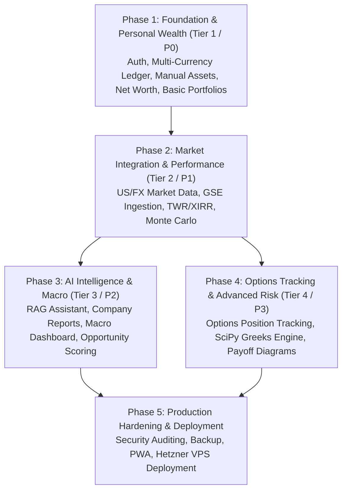

# Investment & Wealth Intelligence Platform

## Detailed Product Requirements and Technical Architecture

**Document version:** 1.3 (Phases 1–5 Implemented — Pending Target Host Runtime Execution)
**Last updated:** 2026-11-11
**Product type:** Personal-first Web Application / PWA, architected for multiple users
**Primary reporting currency:** GHS
**Initial deployment:** Private cloud VPS
**Architecture:** Modular monolith, API-first, multi-user-ready
**Frontend:** Vue 3 + Tailwind CSS + shadcn-vue
**Backend:** Python FastAPI
**Database:** PostgreSQL
**AI infrastructure:** Cloud AI APIs

---

# 1. Product Vision

Build a comprehensive financial platform that enables individuals to manage their financial assets, monitor investments, project future wealth, analyze financial markets and discover emerging investment opportunities through artificial intelligence.

The application should combine capabilities found in:

- Personal Capital/Empower: wealth tracking and portfolio management.
- Portfolio Performance: investment performance and dividend tracking.
- TradingView: market analysis and charts.
- Seeking Alpha: company research and investment insights.
- Bloomberg Terminal: market intelligence and economic monitoring.
- Financial planning software: projections and scenario analysis.

These are product inspirations, not requirements to replicate their complete feature sets.

## 1.1 Product objectives

1. Provide a consolidated view of a user's financial position.
2. Track financial assets and liabilities across currencies.
3. Monitor investments across multiple international markets.
4. Track equity holdings and options contracts.
5. Provide reliable investment performance analytics.
6. Model future financial outcomes under different assumptions.
7. Identify investment opportunities using quantitative analysis and AI.
8. Monitor economic, political and industry developments.
9. Generate personalized financial and investment research.
10. Support multiple users with secure data isolation.

## 1.2 Target users

- Individual investors.
- Long-term wealth builders.
- Stock and ETF investors.
- Options traders.
- Emerging-market investors.
- Users managing assets across multiple countries.

---

# 2. Functional Requirements

## Module 1: User Management and Authentication

The initial deployment is intended for personal use. The architecture must support additional users later without redesigning core data ownership, authentication or authorization.

### Requirements

- User registration.
- Email verification.
- Secure login and logout.
- Password reset.
- Multi-factor authentication.
- User profile management.
- User preferences.
- Currency and regional settings.
- Session management.
- Account deletion and data export.
- Subscription and plan management (future).

### User roles

| Role                | Permissions                                  |
| ------------------- | -------------------------------------------- |
| Owner / Super Admin | Full administration of the personal instance |
| Standard User       | Own financial information                    |
| Analyst (future)    | Explicitly authorized research access        |
| Read-only (future)  | View explicitly permitted information        |

Keep the initial role model simple. Add organization-level roles and subscription administration only if the product becomes a shared SaaS service.

### Security requirement

Every user-owned financial record must be associated with a user or tenant identifier.

All database queries and API operations must enforce ownership checks. A user must never be able to retrieve another user's financial information by manipulating an ID.

---

## Module 2: Wealth and Asset Management

This module maintains the user's complete financial position.

### Supported asset categories

**Cash and cash equivalents**

- Bank accounts.
- Mobile money.
- Cash holdings.
- Foreign currency accounts.

**Investment assets**

- Listed shares.
- ETFs.
- Mutual funds.
- Money market funds.
- Treasury bills.
- Government bonds.
- Corporate bonds.
- Options contracts.

**Alternative assets**

- Real estate.
- Land.
- Vehicles.
- Precious metals.
- Private business ownership.
- Other investments.

**Liabilities**

- Personal loans.
- Mortgages.
- Credit card balances.
- Business loans.
- Other outstanding obligations.

### Functional requirements

- Create and edit assets.
- Record purchases and sales.
- Record contributions and withdrawals.
- Maintain current asset valuations.
- Maintain historical valuations.
- Track asset maturity dates.
- Record asset ownership percentages.
- Track income generated by assets.
- Categorize assets.
- Calculate total assets.
- Calculate total liabilities.
- Calculate net worth.

### Core calculation

Net worth = Total Assets - Total Liabilities.

The application must support manual valuations for assets without publicly available market prices.

---

## Module 3: Investment Portfolio Management

This module tracks investment positions across supported markets.

### Supported markets

| Market           | Coverage                                                        |
| ---------------- | --------------------------------------------------------------- |
| Ghana            | GSE-listed securities                                           |
| United States    | NYSE, NASDAQ and supported exchanges                            |
| Africa           | Nigeria, Kenya, South Africa, Egypt and other supported markets |
| Global           | International securities and ETFs                               |
| Emerging markets | India, Vietnam, Brazil and other emerging economies             |

Market coverage must be configurable based on available data providers and licensing.

### Functional requirements

- Add securities to portfolios.
- Buy and sell investments.
- Record transaction fees.
- Record taxes.
- Track average purchase price.
- Track cost basis.
- Calculate realized gains and losses.
- Calculate unrealized gains and losses.
- Track dividends.
- Track dividend reinvestment.
- Track stock splits.
- Track bonus shares.
- Monitor portfolio allocation.
- Compare portfolio performance against benchmarks.
- Track investment performance over custom periods.

### Portfolio metrics

- Total portfolio value.
- Total invested capital.
- Realized profit/loss.
- Unrealized profit/loss.
- Dividend income.
- Total return.
- Annualized return.
- Time-weighted return.
- Money-weighted return (XIRR).
- Asset allocation.
- Sector exposure.
- Geographic exposure.
- Currency exposure.

### Portfolio grouping

Users should be able to maintain multiple portfolios.

Examples:

- Ghana Stock Portfolio.
- US ETF Portfolio.
- Long-term Wealth Portfolio.
- Options Trading Portfolio.
- Retirement Portfolio.

---

## Module 4: Options Trading Management

This module is separate from ordinary equity holdings because options require different accounting, valuation and risk calculations.

### Supported contracts

**Call options**

- Long calls.
- Short calls.
- Covered calls.
- Uncovered calls.

**Put options**

- Long puts.
- Short puts.
- Cash-secured puts.
- Other supported strategies.

### Contract information

- Underlying instrument.
- Option symbol.
- Option type.
- Strike price.
- Expiration date.
- Contract multiplier.
- Number of contracts.
- Premium.
- Entry price.
- Current market price.
- Bid and ask.
- Implied volatility.
- Open interest.
- Trading volume.
- Exercise style.
- Settlement method.

### Options Greeks

- Delta.
- Gamma.
- Theta.
- Vega.
- Rho.

### Options analytics

- Maximum potential profit.
- Maximum potential loss.
- Break-even price.
- Intrinsic value.
- Extrinsic value.
- Time decay.
- Probability of expiring in the money (when supported by a suitable model).
- Implied volatility analysis.
- Strategy payoff diagrams.

### Options strategies

The system should support:

- Long call.
- Long put.
- Covered call.
- Cash-secured put.
- Bull call spread.
- Bear put spread.
- Iron condor.
- Straddle.
- Strangle.

### Important distinction

Options valuation must use a dedicated quantitative engine. Black-Scholes may be appropriate for certain European-style contracts, while American-style options may require binomial or other suitable models.

Market prices and implied volatility should take precedence over theoretical values when reliable quotes are available.

The initial options data coverage should prioritize US-listed contracts. Do not assume that GSE or other African exchanges offer accessible listed equity options markets.

---

## Module 5: Financial Forecasting and Wealth Projection

This is one of the platform's core differentiators.

Users must be able to project future financial outcomes by changing assumptions.

### Input parameters

- Initial investment.
- Current asset value.
- Monthly contributions.
- Annual contributions.
- Expected annual return.
- Investment period.
- Dividend yield.
- Dividend reinvestment.
- Inflation rate.
- Currency depreciation.
- Management fees.
- Taxes.
- Contribution growth rate.

### Forecasting models

**A. Compound growth**

Calculate the future value of an initial investment and recurring contributions.

**B. Dividend reinvestment**

Model the impact of reinvesting dividends.

**C. Inflation-adjusted projections**

Display future nominal wealth and estimated purchasing power in today's currency.

**D. Currency scenarios**

Simulate the impact of exchange-rate movements on international investments.

**E. Monte Carlo simulation**

Run thousands of possible market paths using specified assumptions and suitable return distributions.

**F. Market stress testing**

Simulate:

- 10% market decline.
- 20% market decline.
- 40% market decline.
- High inflation.
- Currency depreciation.
- Interest-rate changes.

### Projection outputs

- Projected wealth.
- Total contributions.
- Investment gains.
- Annual growth.
- Monthly growth.
- Inflation-adjusted wealth.
- Probability of achieving financial goals.
- Bear, base and bull scenarios.

The system must distinguish assumed returns from forecasts and historical returns.

---

## Module 6: Financial Goals and Planning

Allow users to establish financial goals.

### Examples

- Accumulate GH₵500,000.
- Build a retirement portfolio.
- Purchase a property.
- Generate GH₵5,000 monthly passive income.
- Build an emergency fund.
- Reach a target net worth.

### Requirements

- Create financial goals.
- Define target amounts.
- Set target dates.
- Associate assets and portfolios with goals.
- Calculate progress.
- Project goal completion dates.
- Calculate required monthly contributions.
- Generate alerts when progress falls behind expectations.

---

## Module 7: Market Data Intelligence

This module collects, validates and stores financial information.

### Market data

- Current or delayed prices.
- Historical prices.
- Open, high, low and close.
- Trading volume.
- Market capitalization.
- Stock indices.
- ETF prices.
- Currency exchange rates.
- Corporate actions.

### Fundamental data

- Revenue.
- Operating expenses.
- Operating income.
- Net income.
- Earnings per share.
- Total assets.
- Total liabilities.
- Shareholders' equity.
- Operating cash flow.
- Free cash flow.
- Dividends.

### Economic indicators

- GDP growth.
- Inflation.
- Interest rates.
- Unemployment.
- Government debt.
- Fiscal deficit.
- Foreign exchange reserves.
- Trade balance.
- Currency performance.
- Commodity prices.

### Data providers

| Data             | Initial sources                               |
| ---------------- | --------------------------------------------- |
| Ghana equities   | GSE publications, StatsGH and broker records  |
| US equities      | Twelve Data, FMP or Alpha Vantage             |
| African equities | Exchange publications and available providers |
| Global ETFs      | International market data APIs                |
| Macroeconomics   | World Bank, IMF, FRED, Bank of Ghana          |
| US filings       | SEC EDGAR                                     |
| Company reports  | Investor relations websites                   |
| News             | GDELT, RSS and authorized news APIs           |
| Currency         | Bank of Ghana and international FX providers  |

The data provider layer must be interchangeable. Provider quotas, symbol coverage, delays, permitted use, redistribution rights and retention terms must be checked before enabling a source in production.

Every data record must retain its source, observation date, retrieval date, currency/unit where relevant, and quality status. Preserve raw source payloads or source documents where legally and operationally practical.

---

## Module 8: AI Investment Intelligence

This module uses cloud AI APIs to analyze verified financial information.

### AI capabilities

**1. Company intelligence**

- Analyze company financial statements.
- Evaluate financial health.
- Compare competing companies.
- Identify valuation anomalies.
- Analyze dividend sustainability.
- Generate company research reports.

**2. Sector intelligence**

- Identify expanding industries.
- Detect structural growth trends.
- Monitor sector performance.
- Identify potential beneficiaries of economic changes.

**3. Emerging market discovery**

- Compare economic performance between countries.
- Identify improving macroeconomic conditions.
- Monitor foreign investment flows.
- Detect industry growth.
- Identify potential investment opportunities.

**4. News intelligence**

- Summarize financial news.
- Identify company-specific developments.
- Detect policy changes.
- Analyze potential investment implications.
- Identify geopolitical and economic risks.

**5. Portfolio intelligence**

- Evaluate portfolio diversification.
- Identify concentration risks.
- Analyze underperforming holdings.
- Identify exposure to currency movements.
- Evaluate portfolio alignment with investment goals.

### Investment opportunity scoring

Create a quantitative scoring model.

| Factor                     | Suggested weight |
| -------------------------- | ---------------: |
| Fundamental strength       |              25% |
| Valuation                  |              20% |
| Growth potential           |              20% |
| Market and sector momentum |              15% |
| Macroeconomic outlook      |              10% |
| Risk assessment            |              10% |
| Total                      |             100% |

The scoring system must be configurable and calibrated separately for different asset classes and markets.

AI should explain the scores rather than invent them.

### Research report structure

Every generated report should contain:

1. Executive summary.
2. Investment thesis.
3. Market overview.
4. Company financial analysis.
5. Valuation.
6. Growth catalysts.
7. Competitive position.
8. Key risks.
9. Bear, base and bull scenarios.
10. Data sources and publication dates.
11. Confidence and data completeness.
12. Conditions that would invalidate the investment thesis.

AI-generated reports must not be treated as guaranteed investment recommendations.

---

## Module 9: Risk and Portfolio Analytics

### Requirements

- Portfolio volatility.
- Maximum drawdown.
- Sharpe ratio.
- Sortino ratio.
- Asset correlation.
- Sector concentration.
- Geographic concentration.
- Currency exposure.
- Portfolio beta.
- Value at Risk (VaR).
- Conditional Value at Risk (CVaR).
- Stress testing.

Risk models should identify missing historical data and distinguish estimates from observed values.

---

## Module 10: Market News and Events

### Requirements

- Collect financial news.
- Monitor company announcements.
- Monitor central bank announcements.
- Monitor inflation releases.
- Monitor earnings announcements.
- Monitor dividend announcements.
- Monitor government policy changes.
- Classify events by country, sector and company.
- Link news to affected portfolio holdings.
- Generate notifications.

Each article should retain its original URL, publisher, publication date and collection date.

Use licensed news sources and permitted feeds.

---

## Module 11: AI Financial Assistant

The user should be able to interact with the application conversationally.

Example questions:

- What is my current net worth?
- How much did I earn from dividends this year?
- What is my portfolio's annualized return?
- What happens if I increase contributions to GH₵1,000?
- Compare MTN Ghana with GCB Bank.
- Which African banking markets are improving?
- Explain the risks in my options portfolio.
- Which of my investments have significant currency exposure?

The assistant should retrieve information through authorized backend tools.

It must not access another user's portfolio or execute trades without explicit authorization and a separate secure trading integration.

---

# 3. User Interface Requirements

## Main navigation

1. Overview
2. My Wealth
3. Portfolios
4. Stock Options
5. Markets
6. Research & Intelligence
7. Forecasting
8. Financial Goals
9. News & Events
10. AI Assistant
11. Settings

## Dashboard

The main dashboard should display:

- Total net worth.
- Total assets.
- Total liabilities.
- Investment portfolio value.
- Daily and cumulative performance.
- Dividend income.
- Asset allocation.
- Geographic allocation.
- Currency exposure.
- Future wealth projection.
- Market highlights.
- AI investment insights.
- Upcoming options expirations.
- Important market events.

## Portfolio page

Display:

- Holdings.
- Average purchase price.
- Current price.
- Market value.
- Unrealized gains.
- Realized gains.
- Dividend yield.
- Portfolio contribution.
- Individual performance charts.

## Market intelligence page

Display:

- Country-level market overview.
- Sector performance.
- Economic indicators.
- Emerging opportunities.
- Company watchlists.
- AI research reports.
- Market sentiment.
- News and upcoming events.

## Forecasting page

Provide:

- Projection calculator.
- Interactive parameter controls.
- Historical versus projected wealth.
- Multiple scenarios.
- Monte Carlo probability distributions.
- Inflation-adjusted projections.
- Financial goal tracking.

---

# 4. Technical Architecture

## 4.1 Architecture approach

Use a modular monolith initially.

This avoids unnecessary infrastructure complexity while allowing independent modules to be extracted into microservices as the platform grows.

The backend must expose versioned REST APIs.

## 4.2 Frontend

Use Vue 3 with TypeScript and the Composition API (`<script setup>`). Tailwind CSS provides styling; shadcn-vue supplies source-owned components built on Reka UI primitives. Avoid describing Reka UI as a separate Radix Vue dependency: Radix Vue was renamed to Reka UI.

| Component          | Technology                                                       | Description                                                                                                                        |
| ------------------ | ---------------------------------------------------------------- | ---------------------------------------------------------------------------------------------------------------------------------- |
| Framework          | Vue 3 (TypeScript, Composition API)                              | `<script setup>` syntax for type safety and clean code structure                                                                 |
| Styling            | Tailwind CSS                                                     | Utility-first styling enabling high information density and responsive layout                                                      |
| UI Primitives      | shadcn-vue + Reka UI                                             | Accessible primitives and source-owned components (`src/components/ui`)                                                          |
| Icons              | `lucide-vue-next`                                              | Crisp, consistent financial and UI iconography                                                                                     |
| Complex Tables     | `@tanstack/vue-table`                                          | Headless data tables for dense portfolio holdings, transactions, and screeners                                                     |
| State management   | Pinia                                                            | Modular reactive store architecture                                                                                                |
| Routing            | Vue Router                                                       | Dynamic routing with route-level auth guards                                                                                       |
| HTTP               | Axios                                                            | Custom client with automatic JWT token refresh interceptors                                                                        |
| Charts             | Apache ECharts; TradingView Lightweight Charts where appropriate | Financial charting, candlesticks and projections; review each library's licence and attribution requirements before production use |
| Forms & Validation | VeeValidate + Zod                                                | Type-safe form validation schemas                                                                                                  |
| PWA                | Vite PWA                                                         | Offline caching and installable progressive web application                                                                        |

### UI Design Philosophy & Principles

1. **High Information Density:** Financial dashboards require compact spacing (`p-1`, `p-2`, `text-xs`/`text-sm`), tight data grids, and clean borders rather than oversized, mobile-spaced Material Design cards.
2. **Dark-Mode First Aesthetic:** Designed with institutional themes (deep slates, subtle borders, high-contrast typography, and muted green/red gain-loss indicators) inspired by TradingView, Koyfin, and Stripe.
3. **Keyboard-Driven Command Palette (`Cmd + K`):** Built-in global search palette enabling instant search and jump navigation across stock tickers (e.g. `AAPL`, `MTNGH`), asset accounts, portfolio pages, and action shortcuts.
4. **Source-Owned Components:** UI components are kept directly in `src/components/ui`, preventing lock-in to external component package breaking changes and allowing custom financial widget modifications.

## 4.3 Backend

| Component             | Technology   |
| --------------------- | ------------ |
| Framework             | FastAPI      |
| Language              | Python       |
| ORM                   | SQLAlchemy   |
| Migrations            | Alembic      |
| Validation            | Pydantic     |
| Authentication        | OAuth2 / JWT |
| Background processing | Celery       |
| Queue and cache       | Redis        |
| API documentation     | OpenAPI      |

## 4.4 Financial and quantitative engine

Use:

- NumPy.
- Pandas.
- SciPy.
- Scikit-learn.
- QuantLib-Python for advanced financial modelling where appropriate.

Do not delegate deterministic financial calculations to LLMs.

## 4.5 AI infrastructure

Create an AI provider abstraction.

Initial provider:

- OpenAI API.

Future providers:

- Anthropic.
- Google Gemini.

AI integration should support:

- Tool calling.
- Structured outputs.
- Document analysis.
- Embeddings.
- Retrieval-augmented generation.
- Model selection by task.
- Usage tracking.
- Provider fallbacks.

## 4.6 Infrastructure

| Component     | Technology                |
| ------------- | ------------------------- |
| Hosting       | Hetzner VPS               |
| Containers    | Docker                    |
| Reverse proxy | Traefik                   |
| Database      | PostgreSQL                |
| Cache         | Redis                     |
| Monitoring    | Prometheus + Grafana      |
| Logs          | Loki                      |
| Backups       | Encrypted offsite backups |
| CI/CD         | GitHub Actions            |

The initial deployment should not require a GPU.

---

# 5. Database Architecture

Use PostgreSQL with logically separated schemas. For the personal-first release, enforce `user_id` ownership on every user-owned row. If organization/household tenants are introduced, add `tenant_id` and membership relationships rather than assuming `user_id` alone is a complete tenant model.

## Core schemas

### `identity`

- users
- user_profiles
- roles
- permissions
- user_sessions
- user_preferences

### `wealth`

- assets
- asset_categories
- liabilities
- asset_valuations
- financial_accounts
- financial_transactions
- recurring_transactions

### `investments`

- portfolios
- portfolio_holdings
- investment_transactions
- dividends
- corporate_actions
- benchmarks
- watchlists

### `markets`

- exchanges
- countries
- instruments
- instrument_prices
- market_indices
- currencies
- exchange_rates
- market_sessions

### `fundamentals`

- financial_statements
- company_metrics
- company_profiles
- company_events
- financial_periods

### `options`

- option_contracts
- option_positions
- option_transactions
- option_quotes
- option_greeks
- option_strategies
- option_expirations

### `economics`

- economic_indicators
- economic_observations
- country_economic_profiles
- commodity_prices

### `intelligence`

- news_articles
- market_events
- sector_analysis
- opportunity_scores
- research_reports
- ai_conversations
- ai_messages
- ai_usage_logs

### `forecasting`

- forecast_scenarios
- forecast_assumptions
- forecast_results
- monte_carlo_runs
- financial_goals

### `infrastructure`

- data_providers
- data_sources
- ingestion_jobs
- ingestion_logs
- data_quality_checks
- audit_logs

## Important database rules

1. Use UUID primary keys for user-owned entities.
2. Enforce user ownership in every query and write path; add PostgreSQL Row-Level Security (RLS) as defence in depth where practical.
3. Use decimal/numeric types for monetary values.
4. Store timestamps in UTC.
5. Store the original transaction currency.
6. Preserve exchange rates at transaction time.
7. Preserve market data source attribution.
8. Support historical corrections and corporate actions.
9. Avoid deleting financial transactions; use reversal and correction records.
10. Implement database migrations through Alembic.

---

# 6. Financial Business Rules

These rules are critical to the reliability of the application.

## Multi-currency accounting

GHS should be the default reporting currency.

Every financial transaction must retain:

- Transaction currency.
- Original amount.
- Exchange rate.
- Reporting currency.
- Converted amount.
- Exchange rate source.
- Exchange rate date.

Never overwrite original transaction values when exchange rates change.

## Investment performance

Calculate:

- Realized gain/loss.
- Unrealized gain/loss.
- Total return.
- Dividend income.
- Time-weighted return.
- Money-weighted return.

Clearly distinguish market-price movements from foreign exchange gains and losses.

## Corporate actions

Support:

- Stock splits.
- Reverse splits.
- Bonus issues.
- Rights issues.
- Dividend distributions.
- Mergers and delistings.

## Options accounting

Track the contract multiplier, premium, fees, expiration, exercise, assignment and settlement.

For example, an options contract with a multiplier of 100 represents exposure to 100 underlying shares, subject to contract specifications.

Never assume every option contract has the same multiplier.

## Forecasting

Every projection must retain:

- Assumptions.
- Model version.
- Calculation date.
- Market data snapshot.
- Forecast horizon.
- Scenario configuration.

This makes projections reproducible.

---

# 7. Data Acquisition Strategy

The platform must use a provider-independent ingestion system.

## Initial sources

| Category                 | Primary Sources & Fallbacks                                                                        | Ingestion Method                                                            | Cost / Tier                                                |
| ------------------------ | -------------------------------------------------------------------------------------------------- | --------------------------------------------------------------------------- | ---------------------------------------------------------- |
| Ghana equities           | GSE Daily Official List (DOL), if publicly available in a usable format                            | Admin CSV upload first; PDF parsing only after format and access validation | No assumed API fee; verify access and reuse terms          |
| US equities & ETFs       | Twelve Data / FMP; yfinance as a best-effort fallback                                              | Provider adapter / scheduled EOD ingestion                                  | Free tiers subject to limits; verify terms and coverage    |
| African markets          | Exchange publications, local broker sheets                                                         | CSV / Excel upload / PDF                                                    | Free / Manual                                              |
| Global ETFs              | Twelve Data / FMP; yfinance as a best-effort fallback                                              | Provider adapter / scheduled EOD ingestion                                  | Free tiers subject to limits; verify terms and coverage    |
| Macroeconomics           | World Bank API / IMF API                                                                           | Automated REST API                                                          | 100% Free public API                                       |
| Ghana economic data      | Bank of Ghana publications & press releases                                                        | Weekly PDF / Manual entry                                                   | Free / Manual                                              |
| US economic data         | FRED (Federal Reserve Economic Data)                                                               | Automated REST API                                                          | 100% Free with key                                         |
| Company filings          | SEC EDGAR                                                                                          | Automated REST API                                                          | 100% Free public API                                       |
| News & Events            | RSS feeds (Reuters, Bloomberg, Citi/Joy) & GDELT                                                   | Automated RSS / JSON ingestion                                              | 100% Free                                                  |
| Currency (FX)            | Bank of Ghana for GHS where available; verify ExchangeRate-API or another provider for other pairs | Automated REST API / controlled manual fallback                             | Free tier or public source; confirm GHS coverage and terms |
| Personal Accounts & MoMo | Bank statements & MTN MoMo / Telecel Cash                                                          | User CSV & PDF statement upload                                             | Manual / User upload                                       |
| Stock Options            | User trade entry + Local Python pricing engine                                                     | Manual entry + SciPy Greeks engine                                          | Zero API cost                                              |

## 7.1 Public APIs vs. File/Manual Ingestion Breakdown

### 1. Public and Free-Tier Automated APIs

- **World Bank & IMF APIs:** Free public REST endpoints for global macro data (GDP growth, public debt, inflation, population, FDI flows) without API key barriers.
- **FRED API (St. Louis Fed):** Free API key offering thousands of economic series, US interest rates, Treasury yield curves, and international commodity benchmarks (Gold, Crude Oil, Cocoa).
- **SEC EDGAR API:** Free SEC submissions and company-facts JSON/XBRL data for US company filings and reported fundamentals; observe SEC fair-access requirements and filing publication timing.
- **US Equities & ETFs:** Evaluate `yfinance` as an unofficial, best-effort source and Twelve Data/FMP free tiers as provider options. Do not hardcode call limits or assume production rights; verify current quotas, symbol coverage, delays and terms before implementation.
- **FX:** Use Bank of Ghana or a provider whose supported currency list explicitly includes GHS. Do not assume Frankfurter supports GHS; verify coverage before selecting it.
- **News & Sentiment:** RSS aggregation (Reuters, Bloomberg, local African portals) and GDELT open event database.

### 2. Semi-Automated & File/Manual Ingestion Pipeline

- **Ghana Stock Exchange (GSE):** Use a two-stage approach, subject to confirming that the relevant publications are publicly accessible and may be collected and stored:
  1. *Admin CSV Uploader:* Make this the dependable initial ingestion method for closing prices and volumes.
  2. *Optional PDF Collector:* After validating the Daily Official List's availability, layout stability and permitted automated access, schedule a Celery job after publication and parse it with `pdfplumber`. Do not assume a fixed publication time or stable PDF layout. Retain the original document and flag parsing exceptions for review.
- **Bank of Ghana T-Bills & Policy Rates:** Collect from official auction-result publications where available, with admin entry/import as a fallback. Preserve auction date, tenor, rate convention, publication date and source document.
- **Local Bank & Mobile Money (MoMo) Balances:** Begin with manual balances and CSV/PDF statement imports. Treat direct bank or mobile-money connectivity as a future integration requiring provider-by-provider availability, authorization and commercial-term checks.
- **Broker Trade Confirmations:** Universal CSV trade import format (`Date`, `Ticker`, `Exchange`, `Action`, `Quantity`, `Price`, `Fees`, `Currency`).
- **Alternative Assets (Real Estate, Land, Vehicles):** Maintained via explicit periodic valuation records with method attribution (purchase cost, independent appraisal, estimated market value).

### 3. Options Tracking Without a Paid Options-Chain Subscription

- **Problem:** Streaming commercial OPRA options chains with real-time Greeks costs between $100–$300+/month.
- **Approach:**
  1. Users record positions manually (underlying ticker, strike, expiration, call/put, premium paid/received, contracts and contract multiplier).
  2. The system retrieves an underlying price where a suitable free source is available.
  3. Users may enter an option quote and implied volatility when available; otherwise, the engine calculates clearly labelled theoretical values and Greeks using suitable Black-Scholes or binomial assumptions.
  4. Payoff-at-expiration can be calculated from contract terms without a live options chain.
  5. Display data freshness and distinguish *market quote*, *user-entered quote* and *model estimate*. The quantitative engine can avoid a paid options-chain subscription, but it cannot provide live market Greeks without reliable option quotes and volatility inputs.

## Data ingestion architecture

1. Collect information from authorized providers.
2. Store the raw response or source document.
3. Normalize data into standard formats.
4. Validate symbols, dates, currencies and values.
5. Detect duplicates.
6. Compare against previous observations.
7. Store validated records.
8. Notify administrators of failures.
9. Make validated data available to analytical engines.

## Data quality levels

- Verified: authoritative or independently reconciled.
- Provider sourced: obtained from a recognized provider.
- Estimated: calculated using available information.
- Manual: entered by a user.
- Stale: outside the expected update period.

The AI engine must receive data quality information with its inputs.

---

# 8. AI and Investment Research Architecture

## Research pipeline

1. Collect market and economic information.
2. Identify relevant countries, sectors and companies.
3. Calculate financial indicators.
4. Generate quantitative opportunity scores.
5. Retrieve supporting documents and news.
6. Send relevant information to the AI provider.
7. Generate a structured research report.
8. Validate the output.
9. Store the report and source references.
10. Display the report to the user.

## AI security requirements

- Never expose provider API keys to the frontend.
- Apply user-specific authorization before retrieving portfolio information.
- Minimize personal information sent to external AI providers.
- Treat retrieved documents and news as untrusted inputs.
- Prevent external documents from overriding system instructions.
- Validate AI-generated structured responses.
- Keep AI-generated insights separate from verified financial records.
- Log model usage and analysis versions.

---

# 9. API Design

Use versioned endpoints.

Base URL:

`/api/v1`

## Authentication

- POST `/auth/register`
- POST `/auth/login`
- POST `/auth/refresh`
- POST `/auth/logout`
- POST `/auth/password-reset`

## Wealth

- GET `/wealth/summary`
- GET `/wealth/assets`
- POST `/wealth/assets`
- PATCH `/wealth/assets/{id}`
- GET `/wealth/liabilities`
- POST `/wealth/valuations`

## Portfolios

- GET `/portfolios`
- POST `/portfolios`
- GET `/portfolios/{id}`
- GET `/portfolios/{id}/holdings`
- POST `/portfolios/{id}/transactions`
- GET `/portfolios/{id}/performance`
- GET `/portfolios/{id}/dividends`

## Markets

- GET `/markets/countries`
- GET `/markets/exchanges`
- GET `/markets/instruments`
- GET `/markets/instruments/{id}/prices`
- GET `/markets/indices`
- GET `/markets/exchange-rates`

## Options

- GET `/options/contracts`
- POST `/options/positions`
- GET `/options/positions`
- GET `/options/positions/{id}`
- POST `/options/strategies`
- GET `/options/analytics/{id}`

## Forecasting

- POST `/forecasting/simulations`
- GET `/forecasting/scenarios`
- POST `/forecasting/scenarios`
- GET `/forecasting/results/{id}`
- POST `/forecasting/monte-carlo`

## AI intelligence

- POST `/intelligence/company-analysis`
- POST `/intelligence/market-analysis`
- POST `/intelligence/sector-analysis`
- GET `/intelligence/opportunities`
- GET `/intelligence/reports`
- POST `/intelligence/assistant/chat`

## Financial goals

- GET `/goals`
- POST `/goals`
- PATCH `/goals/{id}`
- GET `/goals/{id}/progress`

All endpoints must apply authentication, authorization, input validation and rate limiting.

---

# 10. Security and Privacy

Security is a core requirement, not a later enhancement.

Implement:

- HTTPS everywhere.
- Password hashing using Argon2id.
- Multi-factor authentication.
- Role-based access control.
- Tenant isolation.
- Database encryption at rest where supported.
- Encrypted backups.
- Secrets management.
- Audit logging.
- Rate limiting.
- API request validation.
- CSRF protection where applicable.
- Secure cookie handling.
- Session expiry.
- Data export and deletion procedures.

If the application becomes commercially available in Ghana, assess applicable Data Protection Act requirements and registration obligations with the Data Protection Commission. If it expands into providing regulated investment advice, brokerage or other financial services, obtain appropriate legal and regulatory advice.

---

# 11. Testing Requirements

## Unit testing

- Financial calculations.
- Currency conversion.
- Portfolio accounting.
- Dividend calculations.
- Options valuation.
- Forecasting models.
- Investment scoring.

## Integration testing

- Data provider integrations.
- Database operations.
- Authentication.
- AI provider integrations.
- Background jobs.
- CSV imports.

## Financial correctness testing

Create independent test cases for:

- Buy and sell transactions.
- Partial disposals.
- Stock splits.
- Dividend reinvestment.
- Foreign currency purchases.
- Realized and unrealized gains.
- Options exercise and assignment.
- Expired options.
- Portfolio performance.

## Security testing

- Cross-user data access.
- Authentication bypass.
- SQL injection.
- API abuse.
- Sensitive data leakage.
- Prompt injection.
- Unauthorized report access.

---

# 12. Development Roadmap (Vetted 4-Tier Phased Approach)

## Phase 1: Core Foundation & Wealth Tracker (Tier 1 / P0)

**Status:** Code Implemented (Pending runtime verification, Alembic migration generation, and test suite)
**Estimated duration: 3–4 weeks**

- [x] Project initialization: FastAPI backend (`backend/app/main.py`, `config.py`, `database.py`), Vue 3 + Tailwind CSS frontend (`frontend/src/`), PostgreSQL + Redis config (`docker-compose.yml`).
- [x] Multi-user authentication & row-level tenant data isolation (`backend/app/models/identity.py`, `core/security.py`, `core/deps.py`, `api/v1/auth.py`, `frontend/src/views/LoginView.vue`).
- [x] Multi-currency ledger (`Currency`, `ExchangeRate` in `backend/app/models/markets.py`, `services/currency.py`).
- [x] Wealth & Asset Management: Asset categories, assets, valuations, liabilities, net worth service & UI (`backend/app/models/wealth.py`, `services/wealth.py`, `api/v1/wealth.py`, `frontend/src/views/WealthView.vue`).
- [x] Basic Portfolio Management: Portfolios, holdings, trade entry, portfolio UI (`backend/app/models/investments.py`, `api/v1/portfolios.py`, `frontend/src/views/PortfolioView.vue`).
- [x] Deterministic Wealth Forecasting: Compound growth & goal tracking foundation (`backend/app/services/forecasting.py`, `api/v1/forecasting.py`, `frontend/src/views/ForecastingView.vue`).
- [x] Main Dashboard: Dark-mode UI shell, sidebar layout, and dashboard (`frontend/src/components/layout/`, `frontend/src/views/DashboardView.vue`).

Deliverable: Functional, secure multi-currency personal wealth platform.

## Phase 2: Market Automation & Investment Analytics (Tier 2 / P1)

**Status:** Code Implemented & Verified (GSE CSV ingestion, automated US/ETF/Commodity EOD sync, and Scipy math tests verified)
**Estimated duration: 3–4 weeks**

- [x] Automated EOD market data & FX ingestion service (`backend/app/services/market_data.py`, `api/v1/markets.py`, `frontend/src/views/MarketsView.vue`).
- [x] Global Commodities & Broad-Market ETFs: Integrated `COMMODITIES` market category (`code: COMMODITIES`) and seeded key Ghanaian and international commodities (Gold `GLD`/`GC=F`, Cocoa `CC=F`, Brent Crude Oil `BZ=F`) and core ETFs (`VTI`, `VT`, `BND`, `SPY`, `VOO`, `QQQ`) priced via `yfinance`.
- [x] Self-Service Instrument Registration: Frontend `+ Add Security` modal in `frontend/src/views/MarketsView.vue` allowing users to register any new stock, ETF, commodity, or bond into the market master with instant `Sync EOD` capability.
- [x] GSE Market Connector & Bank of Ghana T-Bill / local market ingestion endpoints & parsers (`backend/app/services/market_data.py`, `api/v1/markets.py`).
- [x] Performance Engine: Return & portfolio analytics (`backend/app/services/performance.py`, `api/v1/portfolios.py`).
- [x] Dividend & corporate action model/service support (`backend/app/models/investments.py`, `services/performance.py`).
- [x] Probabilistic Forecasting: Monte Carlo simulation pathing (`backend/app/services/forecasting.py`, `api/v1/forecasting.py`, `frontend/src/views/ForecastingView.vue`).

Deliverable: Automated investment portfolio, commodities, and returns analytics platform.

## Phase 3: AI Intelligence & Macroeconomic Dashboard (Tier 3 / P2)

**Status:** Code Implemented & Verified (Provenance links, accessible tooltips, multi-factor scoring, and unit tests verified)
**Estimated duration: 3–4 weeks**

- [x] Macroeconomic Intelligence & News aggregation (`backend/app/services/macro.py`, `models/intelligence.py`, `api/v1/intelligence.py`, `frontend/src/views/IntelligenceView.vue`).
- [x] Data Source Provenance & Explainers: Added `source_url`, `acquisition_method` (`LIVE_API` vs `BASELINE_SEED`), `update_cadence`, and plain-language explainers to `EconomicIndicatorResponse`, enriched with accessible `InfoTooltip.vue` components (WCAG 1.4.13 compliant) across Macro Dashboard, Opportunity Scoring, and RSS News.
- [x] AI Financial Assistant (`backend/app/services/ai_intelligence.py`, `api/v1/intelligence.py`, `frontend/src/views/AssistantView.vue`).
- [x] Automated Company Research Reports (`backend/app/services/ai_intelligence.py`, `models/intelligence.py`, `frontend/src/views/IntelligenceView.vue`).
- [x] Quantitative Opportunity Scoring (`backend/app/services/scoring.py`, `api/v1/intelligence.py`, `frontend/src/views/IntelligenceView.vue`).

Deliverable: AI-powered investment intelligence and research platform.

## Phase 4: Options Tracking & Advanced Risk (Tier 4 / P3)

**Status:** Code Implemented (Pending SciPy numerical verification, `vue-tsc` build check, and risk reconciliation tests)
**Estimated duration: 2–3 weeks**

- [x] Options Contract & Position Management (`backend/app/models/options.py` — `OptionPosition`, `OptionTransaction`; `schemas/options.py`; `api/v1/options.py`).
- [x] Local Quantitative Pricing Engine & Greeks (`backend/app/services/options_engine.py` — Black-Scholes & Binomial CRR via `scipy.stats`, `MODEL_ESTIMATED` disclosure).
- [x] Strategy Payoff Visualizer (`compute_strategy_payoff` in `options_engine.py` + SVG payoff curve in `frontend/src/views/OptionsRiskView.vue`).
- [x] Advanced Portfolio Risk & Stress Testing (`backend/app/services/risk.py`, `schemas/risk.py`, `api/v1/risk.py`, Portfolio Risk tab in `frontend/src/views/OptionsRiskView.vue`).
- [x] Frontend routing & navigation wiring (`frontend/src/router/index.ts`, `frontend/src/components/layout/Sidebar.vue`).

Deliverable: Options position accounting, theoretical valuation and risk management module, with market-quote fields available when users provide or later connect an authorized options data source.

## Phase 5: Production Hardening & Deployment

**Status:** Code & Infrastructure Implemented (Pending `pytest`, `vue-tsc`/Vite build, Alembic & Docker execution on target host)
**Estimated duration: 2 weeks**

- [x] Security hardening & audit fixes: `SecurityHeadersMiddleware`, Redis/memory `RateLimitMiddleware` (`backend/app/core/middleware.py`), production secret startup guard (`validate_production_security()` in `config.py`), `/auth/refresh` & `ALLOW_PUBLIC_REGISTRATION` owner lock (`api/v1/auth.py`), `OptionPosition` foreign-portfolio isolation fix (`api/v1/options.py`), 5 MB CSV upload guard (`api/v1/markets.py`), and LLM prompt-injection delimiter isolation (`sanitize_untrusted_text` in `services/ai_intelligence.py`).
- [x] Database migrations: Baseline schema migration (`backend/alembic/versions/0001_initial_schema.py`) covering all 25 tables plus migration/rollback runbook (`_docs/deployment_and_operations.md`).
- [x] Automated test suite: Financial math & Greeks/VaR/XIRR tests (`backend/tests/test_financial_math.py`) and security/cross-tenant isolation tests (`backend/tests/test_security_and_isolation.py`, `backend/pytest.ini`, `backend/requirements-dev.txt`).
- [x] PWA configuration & frontend container: Web manifest (`frontend/public/manifest.webmanifest`), icon (`icon.svg`), offline app-shell Service Worker (`sw.js`, excluding `/api/`), Nginx SPA/API proxy (`frontend/nginx.conf`), and multi-stage `frontend/Dockerfile`.
- [x] Automated database backups & Hetzner VPS deployment stack: `docker-compose.prod.yml` (Traefik v3 Let's Encrypt TLS + isolated internal DB/Redis network), `.env.prod.example`, `scripts/backup_postgres.sh`, and `scripts/restore_postgres.sh` (with `--verify-sandbox` restore drill).

**Revised total estimated duration: 13–17 weeks** (down from 26 weeks due to phased deferrals and optimized zero-cost data strategies).

---

# 13. Prioritization Framework (MoSCoW / 4-Tier Matrix)

### Tier 1: P0 (Must-Have for Initial Usable Release)

- Multi-user authentication & strict row-level tenant isolation.
- Multi-currency accounting (GHS default, locked historical FX rates).
- Asset and liability tracking (Cash, MoMo, Bank, Real Estate, Loans).
- Net worth calculations and visual dashboard.
- Investment portfolio manual entry and universal CSV importer.
- Deterministic financial goal planning & compound growth calculators.
- Responsive Vue 3 + Tailwind CSS + shadcn-vue UI.

### Tier 2: P1 (Should-Have for Market Automation)

- Automated EOD market data for US equities, ETFs, and currencies.
- GSE Daily Official List (DOL) ingestion pipeline (PDF parsing & CSV fallback).
- Bank of Ghana T-Bill rate tracking.
- Portfolio return analytics: Time-Weighted Return (TWR) and XIRR.
- Dividend tracking and reinvestment management.
- Monte Carlo probabilistic wealth projections.

### Tier 3: P2 (Could-Have for AI Differentiation)

- AI Financial Assistant via secure backend tool-calling.
- Macroeconomic dashboard (World Bank, FRED, IMF).
- Automated AI Company Analysis and 12-section research reports.
- Multi-factor quantitative opportunity scoring engine.
- News aggregation and ticker event correlation (RSS + GDELT).

### Tier 4: P3 (Specialized / Later Enhancements)

- Options contract tracking and local Python theoretical Greeks engine (without a paid options-chain feed).
- Multi-leg options strategy payoff visualizer.
- Advanced portfolio stress testing (VaR, CVaR).
- Multiple AI provider fallbacks.
- Automated retail broker API integrations.
- Commercial subscription and billing management.

---

# 14. Key Architectural Decisions

| Decision        | Recommendation                                      | Notes                                                                                 |
| --------------- | --------------------------------------------------- | ------------------------------------------------------------------------------------- |
| Architecture    | Modular monolith                                    | API-first design; extractable to microservices if needed                              |
| User model      | Multi-tenant capable                                | Row-level `user_id` isolation across all wealth and portfolio tables                |
| Frontend        | Vue 3 + Tailwind CSS + shadcn-vue                   | Source-owned components, Lucide icons, TanStack Table, dark-mode first                |
| Backend         | FastAPI (Python)                                    | High performance, async I/O, Pydantic v2 validation, auto OpenAPI docs                |
| Database        | PostgreSQL 16                                       | ACID-compliant, UUID keys, NUMERIC(18,4) monetary precision                           |
| Market data     | Hybrid Ingestion Pipeline                           | Free automated APIs (FRED, World Bank, yfinance) + Daily PDF/CSV parser for GSE       |
| Ghana data      | GSE Official List PDF + BoG Press Releases          | Automated PDF scraper with manual admin CSV upload fallback                           |
| AI              | Cloud API integration (OpenAI / Gemini / Anthropic) | Strict JSON schemas, RAG with verified financial data, secure tool-calling            |
| Forecasting     | Python quantitative engine                          | Deterministic compound growth + NumPy vectorized Monte Carlo simulation               |
| Options         | Zero-cost local quantitative engine                 | SciPy/QuantLib Black-Scholes & Binomial models using underlying stock quotes          |
| Currency        | Multi-currency with GHS reporting                   | Preserves original transaction currency and historical exchange rate at time of trade |
| Hosting         | Hetzner VPS                                         | Cost-effective private cloud hosting without GPU requirements                         |
| Deployment      | Docker Compose + Traefik                            | Automated SSL via Let's Encrypt, isolated container networks                          |
| Background jobs | Celery + Redis                                      | Asynchronous market data ingestion, report generation, and caching                    |
| Security        | MFA, RBAC, tenant isolation                         | Argon2id password hashing, JWT auth, prompt-injection defense                         |
| API             | Versioned REST (`/api/v1`)                        | Enforced authentication, input validation, and rate limiting                          |

---

# 15. Success Criteria

The initial production release should meet these measurable objectives. For the first private release, multi-user support is an architectural capability; onboarding additional users can remain disabled until the owner is ready to operate a shared instance.

1. Users can manage all supported financial asset categories.
2. Portfolio values reconcile with recorded holdings and market prices.
3. Currency conversions are traceable.
4. Financial transactions can be imported and reconciled.
5. Historical portfolio performance can be reproduced.
6. Forecasts are based on explicit, editable assumptions.
7. AI reports include traceable supporting sources.
8. Missing or stale data is clearly identified.
9. Options positions display correct contract exposure and risk.
10. Multiple users can operate without accessing one another's data.
11. The system can change market-data and AI providers without major architectural changes.
12. The application can operate without local AI hardware.

---

# 16. Finalization Notes and Release Gates

## 16.1 Scope clarification

The first release is a private, personal-use deployment. The codebase and data model must be designed so that additional users can be enabled later, but public registration, paid subscriptions, analyst roles and commercial SaaS operations are not P0 requirements.

## 16.2 Data-source verification gates

The following must be verified during implementation rather than treated as guaranteed capabilities:

- GSE Daily Official List availability, publication cadence, document structure, automated-access permission and retention/reuse terms.
- StatsGH availability, API terms, historical depth, symbol coverage and reliability before it is selected as a production source.
- Twelve Data and FMP current free-tier quotas, supported exchanges, delayed versus real-time status, and display/storage rights.
- `yfinance` source terms, stability and suitability. It is a best-effort fallback, not a contractual market-data feed.
- GHS support, rate limits and source methodology for any FX provider.
- RSS publisher terms and whether full text, excerpts or only headlines may be stored and displayed.
- TradingView Lightweight Charts and any other charting library licensing, attribution and redistribution requirements.

No provider should be represented as free, real-time, complete or production-safe until these checks are completed and recorded.

## 16.3 Options-data limitation

The no-paid-options-feed approach supports position bookkeeping, expiration payoff calculations and theoretical valuation. It does not provide a reliable live option mark, live implied volatility or market-derived Greeks without option quotes. The UI must label each value as market-sourced, user-entered or model-estimated and show the underlying data timestamp.

## 16.4 Financial accounting defaults for the first release

Adopt the following implementation defaults. Keep jurisdiction- and asset-specific settings configurable where appropriate. These rules are for portfolio tracking and analytical consistency; they are not a substitute for tax or accounting advice.

| Area                          | First-release default                                                                                                                                                                                                          |
| ----------------------------- | ------------------------------------------------------------------------------------------------------------------------------------------------------------------------------------------------------------------------------ |
| Cost basis                    | Preserve transaction-level tax lots. Use FIFO as the initial disposal convention, with the data model designed to support weighted-average and specific-lot selection later. Do not present this as a tax filing calculation.  |
| Buy-side fees                 | Include transaction fees in acquisition cost for investment performance and cost-basis reporting. Store fees separately as well.                                                                                               |
| Sell-side fees                | Deduct transaction fees from net sale proceeds; store gross proceeds and fees separately.                                                                                                                                      |
| Taxes and withholding         | Record separately by type, amount, currency, date and source. Do not infer tax rates automatically.                                                                                                                            |
| FX spread and conversion fees | Record as explicit conversion costs where known; preserve the actual transaction rate and the reference rate separately when available.                                                                                        |
| Dividends                     | Track declared, ex-dividend, record, payable and received dates; distinguish gross dividend, withholding tax, net cash received and reinvestment.                                                                              |
| Trade dates                   | Record both trade date and settlement date. Use trade-date positions for investment exposure and show unsettled cash/receivables separately until settlement.                                                                  |
| Fractional shares             | Support decimal quantities and fractional-share transactions.                                                                                                                                                                  |
| Negative cash                 | Permit it only when explicitly recorded; flag it as a liability/financing exposure rather than silently netting it away.                                                                                                       |
| Corporate actions             | Preserve raw prices and vendor-adjusted prices separately. Apply splits, bonus issues, rights and other actions to holdings through auditable events; never silently rewrite original transactions.                            |
| TWR                           | Calculate using sub-period valuations around external cash flows, with the chosen valuation frequency and data gaps disclosed.                                                                                                 |
| XIRR / MWR                    | Use dated investor cash flows and a terminal portfolio value; document the sign convention and handle solver failures explicitly.                                                                                              |
| Options                       | Record premium cash flows and fees at trade date. Exercise or assignment creates the corresponding underlying position/cash movement; expiration closes the contract; cash settlement records the contractual cash difference. |
| FX reporting                  | Preserve the historical transaction conversion rate. For current net-worth reporting, use the latest available approved rate and display its source and timestamp.                                                             |

These defaults must be covered by independent test fixtures and reconciliation examples before production use. Where a market's local rules differ, retain the raw facts and make the calculation policy configurable rather than silently applying one jurisdiction's tax treatment.

## 16.5 Operational release gates

A phase is complete only when:

1. Database migrations and rollback/recovery procedures are documented.
2. Unit and integration tests pass.
3. Financial calculations reconcile against independently calculated examples.
4. Cross-user access tests pass.
5. Data-source freshness and failure states are visible.
6. Backups have been restored successfully in a test.
7. Secrets are not stored in source control or frontend bundles.
8. User-facing values identify their source and whether they are delayed, estimated or stale.

## 16.6 Revised roadmap interpretation

The 13–17 week estimate is a focused implementation estimate, not a guarantee. It assumes one primary developer, a controlled MVP scope, reuse of existing infrastructure and no major data-provider or licensing delays. Keep Phase 4 options analytics deferred until the core portfolio ledger and market-data foundation are reliable.

---

# 17. Final Product Direction

The long-term objective is to create a platform with three interconnected capabilities:

**A. Wealth Management**

Know what you own, what you owe, how your investments are performing and how your wealth is changing.

**B. Financial Intelligence**

Understand your investments through quantitative analysis, forecasting, risk modelling and financial research.

**C. Investment Discovery**

Identify promising countries, industries, companies and investment opportunities using macroeconomic data, market trends and AI.

The application should ultimately answer three fundamental questions:

- Where am I financially today?
- Where am I likely to be in the future?
- What opportunities and risks should I investigate now?

**Product philosophy:** Accurate financial data first, reliable quantitative analysis second, AI-powered interpretation third.

---

# 18. Implementation Progress & Verification Status (As of 2026-11-17)

Per Section 16.5 (*Operational release gates*), phases are marked **Code Implemented** rather than **Release Complete** until runtime tests, migrations, and security checks pass against a live database and build environment.

| Phase | Feature Scope | Code Status | Verification & Release Gate Status |
| --- | --- | --- | --- |
| **Phase 1 (P0)** | Auth, Multi-Currency Ledger, Wealth/Net Worth, Basic Portfolios, Deterministic Forecasting, Dashboard | Complete | **Verified:** PostgreSQL models, multi-currency ledger, Alembic baseline schema (`0001_initial_schema`) applied at `head`. |
| **Phase 2 (P1)** | Market Data Ingestion (US/FX/GSE/BoG), Commodities (Gold, Cocoa, Oil), ETFs, Self-Service "+ Add Security" Modal, TWR/XIRR, Dividends, Monte Carlo | Complete | **Verified:** Scipy/financial math tests passing, live `yfinance` commodity & ETF pricing verified, GSE CSV upload verified. |
| **Phase 3 (P2)** | Macro Dashboard with Data Provenance URLs & Accessible Tooltips (`InfoTooltip.vue`), AI Assistant, 12-Section Research Reports, Quantitative Scoring, RSS News | Complete | **Verified:** Unit tests passing (`test_macro_indicator_provenance_and_explainers`), structured JSON outputs, WCAG 1.4.13 tooltip compliance. |
| **Phase 4 (P3)** | Options Bookkeeping, Black-Scholes & Binomial Greeks, Strategy Payoff SVG, Portfolio Risk (HHI, VaR, CVaR) & Stress Tests | Complete | **Verified:** Put-call parity, Greek signs, Binomial vs European convergence, and risk disclosure tests passing (`test_financial_math.py`). |
| **Phase 5** | Migrations, Automated Tests (11/11 passing), Security Audit, PWA, Backups, Docker Compose, Root Makefile, Traefik VPS Deployment | Code & Infra Implemented | **In Progress:** Backend test suite passing (11/11), Vite production bundle building cleanly. Pending: Live remote Hetzner VPS host deployment and `--verify-sandbox` restore drill. |

### Implemented Codebase Inventory

- **Infrastructure, Security & Operations:** `Makefile` (standardized dev/build/test/migrate/seed workflow), `docker-compose.yml`, `docker-compose.prod.yml`, `.env.prod.example`, `backend/Dockerfile`, `backend/requirements.txt`, `backend/requirements-dev.txt`, `backend/pytest.ini`, `backend/alembic/env.py`, `backend/alembic/versions/0001_initial_schema.py`, `backend/.env.example`, `frontend/Dockerfile`, `frontend/nginx.conf`, `frontend/.dockerignore`, `scripts/backup_postgres.sh`, `scripts/restore_postgres.sh`, `_docs/deployment_and_operations.md`
- **Backend Core (`backend/app/core/`):** `security.py`, `deps.py`, `middleware.py`
- **Backend Models (`backend/app/models/`):** `identity.py`, `wealth.py`, `investments.py`, `markets.py` (Exchange, Currency, ExchangeRate, Instrument, InstrumentPrice), `intelligence.py`, `options.py`
- **Backend Schemas (`backend/app/schemas/`):** `auth.py`, `wealth.py`, `portfolio.py`, `markets.py`, `forecasting.py`, `intelligence.py` (enriched `EconomicIndicatorResponse` with provenance metadata), `options.py`, `risk.py`
- **Backend Services (`backend/app/services/`):** `currency.py`, `wealth.py`, `market_data.py` (GSE CSV parser, FX sync, US/ETF/Commodities `yfinance` EOD fetcher, `seed_market_master_data`), `performance.py`, `forecasting.py`, `macro.py` (`MACRO_INDICATOR_PROVENANCE` & `build_indicator_response`), `scoring.py`, `ai_intelligence.py`, `options_engine.py`, `risk.py`
- **Backend API (`backend/app/api/v1/`):** `auth.py`, `wealth.py`, `portfolios.py`, `markets.py` (including `/markets/instruments`, `/markets/seed`, `/markets/sync/us/{symbol}`, `/markets/sync/fx`, `/markets/gse/upload-csv`), `forecasting.py`, `intelligence.py`, `options.py`, `risk.py`, `router.py`
- **Backend Tests (`backend/tests/`):** `test_financial_math.py` (including Black-Scholes, Binomial CRR, strategy payoffs, XIRR, Monte Carlo, portfolio risk HHI, and macro indicator provenance), `test_security_and_isolation.py`
- **Frontend (`frontend/`):**
  - PWA & Build: `index.html`, `package.json`, `tsconfig.json`, `tailwind.config.js`, `public/manifest.webmanifest`, `public/icon.svg`, `public/sw.js`
  - Components: `src/components/layout/AppLayout.vue`, `Sidebar.vue`, `TopNavbar.vue`, `src/components/ui/InfoTooltip.vue` (accessible toggletip with WCAG 1.4.13 keyboard & hover support)
  - Stores & Services: `src/stores/auth.ts`, `src/stores/wealth.ts`, `src/stores/portfolio.ts`, `src/services/api.ts`, `src/lib/utils.ts`
  - Layout & Routing: `src/router/index.ts`
  - Views: `src/views/LoginView.vue`, `DashboardView.vue`, `WealthView.vue`, `PortfolioView.vue`, `MarketsView.vue` (with `+ Add Security` modal and `COMMODITIES` filter), `ForecastingView.vue`, `IntelligenceView.vue` (with data source provenance and explainers), `AssistantView.vue`, `OptionsRiskView.vue`

### Release Gate Verification Commands (Run on Target Host)

1. Run backend test suite: `docker compose exec backend pytest -v` (11/11 tests pass)
2. Run frontend production build: `npm run build` or `npx vite build` (bundles in `dist/`)
3. Verify Alembic baseline migration against PostgreSQL 16: `docker compose exec backend alembic upgrade head`
4. Verify backup & non-destructive restore drill: `./scripts/backup_postgres.sh && ./scripts/restore_postgres.sh <file.sql.gz> --verify-sandbox`
